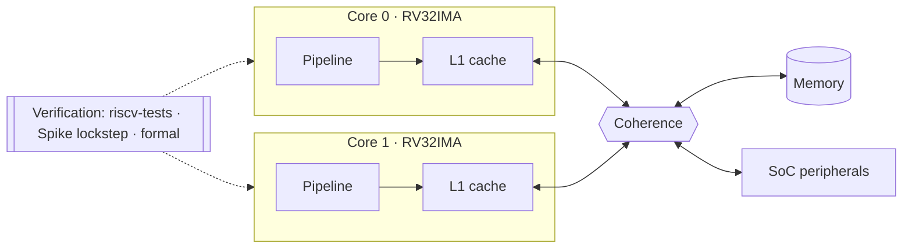

**Digital design · FPGA · PCB design · embedded firmware**

Electrical & Computer Engineering student at the **University of Toronto**, focused on **digital design, FPGA development, and embedded systems**. I like work that ends in something physical: boards that get fabricated, firmware that runs on them, and logic that runs in silicon.

## What I'm working on

- 🔧 **Humber**: a dual-core, cache-coherent RV32IMA system in SystemVerilog for the DE1-SoC, in early setup ([humber-rv32im](https://github.com/Justinlo0502/humber-rv32im))
- 🏁 **Electronics on the [HPVDT](https://hpvdt.ca/) Typhoon vehicle systems**: custom PCBs and STM32 firmware over CAN
- 💪 **Healfy**, an AI-assisted training dashboard
- 🎯 Interested in chip design, FPGA, and embedded system roles

## Humber: planned architecture

*Block-level view from the project plan. Pipeline details will be added as the design lands.*

## Featured projects

| Project | What it is | Tech |
|---|---|---|
| [**humber-rv32im**](https://github.com/Justinlo0502/humber-rv32im) | Dual-core, cache-coherent RV32IMA system for the DE1-SoC, built from public specs, with a verification plan using riscv-tests, Spike lockstep and formal checks (in progress) | SystemVerilog, Verilator, SymbiYosys |
| [**ece342_RCRover_Controller**](https://github.com/Justinlo0502/ece342_RCRover_Controller) | Remote-controlled rover for ECE342: custom PCB (KiCad, silkscreen, layout), firmware for OLED, linear pots, INA, MPU and nRF radio, and a full-duplex radio link, taken through to a working demo | C, STM32, KiCad |
| [**healfy**](https://github.com/Justinlo0502/healfy) | Single-athlete training dashboard and AI coach combining Strava and Garmin data with training-load and HR-zone analysis, plus a Claude-powered chatbot over my own data | Next.js, TypeScript, Prisma, Postgres |
| [**APS360_bonefracture_detection**](https://github.com/Justinlo0502/APS360_bonefracture_detection) | Deep-learning bone fracture detection, final project for APS360 | Python, Jupyter |
| [**FPGA_minor**](https://github.com/Justinlo0502/FPGA_minor) | ECE241 digital systems project on FPGA | Verilog |

### More

- [automatic-irrigation-system](https://github.com/Justinlo0502/automatic-irrigation-system) · [ATcommand_receiver_simulation](https://github.com/Justinlo0502/ATcommand_receiver_simulation) · [teamb10_demodulator](https://github.com/Justinlo0502/teamb10_demodulator)
- [personal-portfolio](https://github.com/Justinlo0502/personal-portfolio) · [GenAIGenesis_Translato](https://github.com/Justinlo0502/GenAIGenesis_Translato) (hackathon)
- Course work: [ece244-labs](https://github.com/Justinlo0502/ece244-labs), [ece244-lab4](https://github.com/Justinlo0502/ece244-lab4)

## HPVDT

I'm on the electronics side of the [University of Toronto Human Powered Vehicle Design Team](https://hpvdt.ca/), a student team that competes at the World Human Powered Speed Challenge in Battle Mountain, Nevada. My work since mid-2024, from the [hpvdt GitHub org](https://github.com/hpvdt):

- **Typhoon motherboard** ([typhoon_motherboard](https://github.com/hpvdt/typhoon_motherboard)): PCB design through Rev 1 finalization and production files, voltage regulation updates, and STM32 firmware bring-up (blinky, CAN loopback test, CAN test against the speed/cadence board).
- **Typhoon power monitor** ([typhoon_power_monitor](https://github.com/hpvdt/typhoon_power_monitor)): Rev 2 board and production files, plus first firmware.
- **Typhoon speed & cadence** ([typhoon_speed_cadence](https://github.com/hpvdt/typhoon_speed_cadence)): board work, firmware, and CAN prototype code.
- **Typhoon environmentals** ([typhoon_environmentals](https://github.com/hpvdt/typhoon_environmentals)): board revisions and production files.
- **Data downlink** ([downlink](https://github.com/hpvdt/downlink)): rerouted and finalized the Rev 2 board, including the debugger header connections.
- **Team website** ([website](https://github.com/hpvdt/website)): updated the member list.

The tools are KiCad for hardware and STM32 firmware.

## Tools & languages

## Get in touch

- 💼 [LinkedIn](https://www.linkedin.com/in/jchlo/)
- 📧 justinchlo0502@example.com
